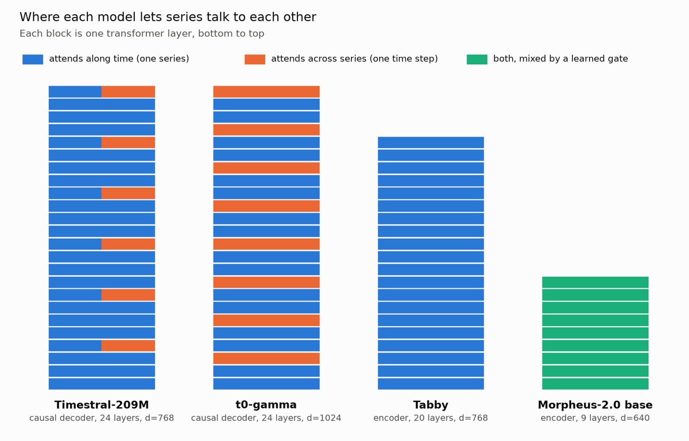

<article class="home-page">
  <header class="home-hero">
    <h1>Hi, I’m Sean.</h1>
    
I build AI systems for a living. In my spare time I pick a question I can’t stop thinking about, build the smallest thing that answers it, and write up what I find.

    
Day job: Head of AI (UK) at Vergence AI, the Palantir–TWG Global joint venture, where my team builds AI systems with clients and ships them to production. Before that: J.P. Morgan, Huawei Research, and a PhD at <a href="https://edinburghnlp.inf.ed.ac.uk/" target="_blank" rel="noopener">EdinburghNLP</a>. <a href="{{ site.cv_pdf }}">CV</a> · <a href="{{ site.linkedin_url }}" target="_blank" rel="noopener">LinkedIn</a>

  </header>

  <section class="content-section" aria-labelledby="recently">
    <h2 id="recently">Recently</h2>
    <ul class="writing-list">
      <li>
        
        

          <a href="https://towardsdatascience.com/timestral-t0-tabby-and-morpheus-20-compared-on-gift-eval/" target="_blank" rel="noopener">Timestral, t0, Tabby, and Morpheus-2.0 compared on GIFT-Eval</a>
          
I re-ran three open time-series foundation models and reproduced their published scores. All four models scale, patch and predict quantiles; the real split is how series share information. <a href="https://github.com/sjmoran/tsfm-gifteval-rerun" target="_blank" rel="noopener">Code</a>.

        

      </li>
      <li>
        
        

          <a href="https://medium.com/@sean.j.moran/finding-the-riemann-zeros-in-a-fourier-transform-of-the-primes-11a1cb7fae10" target="_blank" rel="noopener">Finding the Riemann zeros in a Fourier transform of the primes</a>
          
A Fourier transform of the prime counts up to a trillion recovers all 79 zeta zeros below 200.

        

      </li>
      <li>
        
        

          <a href="https://medium.com/@sean.j.moran/looking-for-an-edge-in-the-uk-lotto-no-ball-bias-a-54p-loss-per-1-and-must-be-won-draws-05774c7f257b" target="_blank" rel="noopener">Looking for an edge in the UK Lotto</a>
          
Three ways a player might beat it, tested on 32 years of draws: the balls look fair, avoiding popular numbers is worth a third of a penny per pound, and about 3 in 10 Must Be Won draws since 2018 were worth slightly more than a ticket.

        

      </li>
      <li>
        
        

          <a href="https://aiadvances.org/what-anthropics-workforce-data-says-about-ai-at-work-67103329c989" target="_blank" rel="noopener">What Anthropic’s workforce data says about AI at work</a>
          
Junior technical hires fell from 27% to 9% while the company tripled, and agents spend about 80% of interactive sessions waiting for a person.

        

      </li>
    </ul>
    
<a href="/writing/">All writing</a>

  </section>

  <section class="content-section" aria-labelledby="built">
    <h2 id="built">Things I’ve built</h2>
    <ul class="plain-list">
      <li><a href="https://sjmoran.github.io/bitbudget/" target="_blank" rel="noopener"><strong>BitBudget</strong></a>: an open benchmark of retrieval quality per byte. One-bit codes with re-ranking match full precision at 32× compression. <a href="https://github.com/sjmoran/bitbudget" target="_blank" rel="noopener">Code</a>.</li>
      <li><a href="https://huggingface.co/spaces/sjmoran/the-corpus-is-the-model" target="_blank" rel="noopener"><strong>The Corpus is the Model</strong></a>: a training-free image tagger whose every prediction traces back to examples in the corpus. Try it in the browser.</li>
      <li><a href="https://github.com/sjmoran/claude-academic-prose" target="_blank" rel="noopener"><strong>claude-academic-prose</strong></a>: a Claude Code skill that strips hype from scientific writing and ties each claim to its evidence.</li>
    </ul>
    
<a href="/talks/">More code, datasets and talks</a>

  </section>

  <section class="content-section" aria-labelledby="selected-research">
    <h2 id="selected-research">Selected research</h2>

    <ol class="selected-list">
      <li class="selected-entry">
        <h3><a href="https://ieeexplore.ieee.org/abstract/document/11262341" target="_blank" rel="noopener">CodeQUEST: Evaluation and Improvement of Code Quality Using LLMs</a></h3>
        
R. Liu, A. Frade, A. Vaidya, M. Labonne, M. Kaiser, B. Chakrabarti, S. Moran. <em>ISSREW, 2025.</em>

        
<a href="https://github.com/jpmorganchase/codequest" target="_blank" rel="noopener">code</a>

      </li>

      <li class="selected-entry">
        <h3><a href="https://arxiv.org/abs/2304.01238" target="_blank" rel="noopener">Spam-T5: Benchmarking LLMs for Few-Shot Email Spam Detection</a></h3>
        
M. Labonne, S. Moran. <em>FinLLM at IJCAI, 2023.</em>

        
<a href="https://github.com/jpmorganchase/llm-email-spam-detection" target="_blank" rel="noopener">code</a>

      </li>

      <li class="selected-entry">
        <h3><a href="https://arxiv.org/abs/2111.04473" target="_blank" rel="noopener">Senatus: A Fast and Accurate Code-to-Code Recommendation Engine</a></h3>
        
F. Silavong, S. Moran, A. Georgiadis, R. Saphal, R. Otter. <em>MSR, 2022.</em>

      </li>

      <li class="selected-entry">
        <h3><a href="https://arxiv.org/abs/2003.13985" target="_blank" rel="noopener">DeepLPF: Deep Local Parametric Filters for Image Enhancement</a></h3>
        
S. Moran, P. Marza, S. McDonagh, S. Parisot, G. Slabaugh. <em>CVPR, 2020.</em>

        
<a href="https://github.com/sjmoran/deep_local_parametric_filters" target="_blank" rel="noopener">code</a><a href="https://www.youtube.com/watch?v=Sxach3FM6FY" target="_blank" rel="noopener">video</a>

      </li>

      <li class="selected-entry">
        <h3><a href="/pdfs/acmicmr2014.pdf">Sparse Kernel Learning for Image Annotation</a></h3>
        
S. Moran, V. Lavrenko. <em>ICMR, 2014. Best Student Paper.</em>

        
<a href="https://github.com/sjmoran/SKLCRM" target="_blank" rel="noopener">code</a>

      </li>

    </ol>

    
<a href="/publications/">All publications</a>

  </section>

</article>
