<article class="home-page">
  <header class="home-hero">
    

      <h1>Hi, I’m Sean.</h1>
      
I build AI systems for a living. In my spare time I pick a question I can’t stop thinking about, build the smallest thing that answers it, and write up what I find.

    <figure class="hero-figure">
      <canvas id="simplex" aria-label="Interactive triangle: each corner is a word, documents are points, and overlapping hills show which word mixes are likely. A new document follows the pointer; clicking adds it." role="img"></canvas>
      <figcaption>Each corner is a word, and every point inside the triangle is a mix of the three. Each document sits at its own word mix and spreads a little probability around itself; where the hills overlap is the kind of text the collection makes likely. Move to try a new document, click to add it, double-click to reset.</figcaption>
      <a class="scroll-cue" href="#recently">Recently ↓</a>
    </figure>
  </header>

  <section class="content-section" aria-labelledby="recently">
    <h2 id="recently">Recently</h2>
    <ul class="card-grid" data-show="4">
      <li class="card">
        
        <h3><a href="https://aiadvances.org/what-anthropics-workforce-data-says-about-ai-at-work-67103329c989" target="_blank" rel="noopener">What Anthropic’s workforce data says about AI at work</a></h3>
        
Junior technical hires fell from 27% to 9% while the company tripled, and agents spend about 80% of interactive sessions waiting for a person.

      </li>
      <li class="card">
        <a class="card-img" href="https://medium.com/@sean.j.moran/finding-the-riemann-zeros-in-a-fourier-transform-of-the-primes-11a1cb7fae10" target="_blank" rel="noopener" aria-hidden="true" tabindex="-1">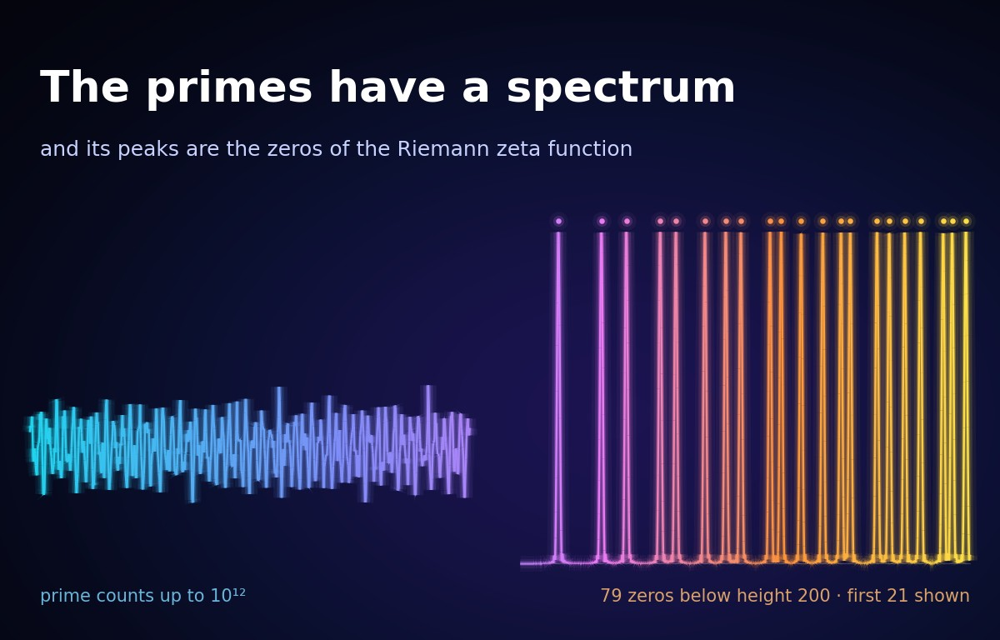</a>
        <h3><a href="https://medium.com/@sean.j.moran/finding-the-riemann-zeros-in-a-fourier-transform-of-the-primes-11a1cb7fae10" target="_blank" rel="noopener">Finding the Riemann zeros in a Fourier transform of the primes</a></h3>
        
A Fourier transform of the prime counts up to a trillion recovers all 79 zeta zeros below 200.

      </li>
      <li class="card">
        <a class="card-img" href="https://medium.com/@sean.j.moran/looking-for-an-edge-in-the-uk-lotto-no-ball-bias-a-54p-loss-per-1-and-must-be-won-draws-05774c7f257b" target="_blank" rel="noopener" aria-hidden="true" tabindex="-1">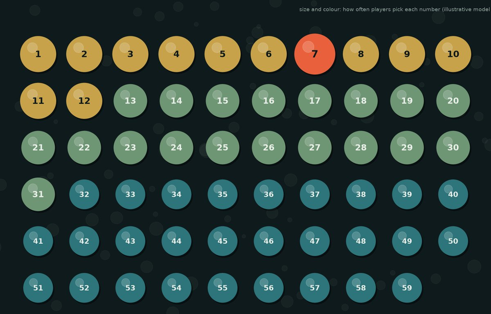</a>
        <h3><a href="https://medium.com/@sean.j.moran/looking-for-an-edge-in-the-uk-lotto-no-ball-bias-a-54p-loss-per-1-and-must-be-won-draws-05774c7f257b" target="_blank" rel="noopener">Looking for an edge in the UK Lotto</a></h3>
        
Three ways a player might beat it, tested on 32 years of draws: the balls look fair, avoiding popular numbers is worth a third of a penny per pound, and about 3 in 10 Must Be Won draws since 2018 were worth slightly more than a ticket.

      </li>
      <li class="card">
        
        <h3><a href="https://towardsdatascience.com/timestral-t0-tabby-and-morpheus-20-compared-on-gift-eval/" target="_blank" rel="noopener">Timestral, t0, Tabby, and Morpheus-2.0 compared on GIFT-Eval</a></h3>
        
I re-ran three open time-series foundation models and reproduced their published scores. All four models scale, patch and predict quantiles; the real split is how series share information. <a href="https://github.com/sjmoran/tsfm-gifteval-rerun" target="_blank" rel="noopener">Code</a>.

      </li>
      <li class="card">
        
        <h3><a href="https://towardsdatascience.com/what-openais-719-math-papers-mean-for-data-science/" target="_blank" rel="noopener">What OpenAI’s 719 Math Papers Mean for Data Science</a></h3>
        
OpenAI released 719 machine-generated math papers in 372 groups of related results.

      </li>
      <li class="card">
        <a class="card-img" href="https://towardsdatascience.com/how-a-frontier-model-gets-built-read-from-the-kimi-k3-report/" target="_blank" rel="noopener" aria-hidden="true" tabindex="-1">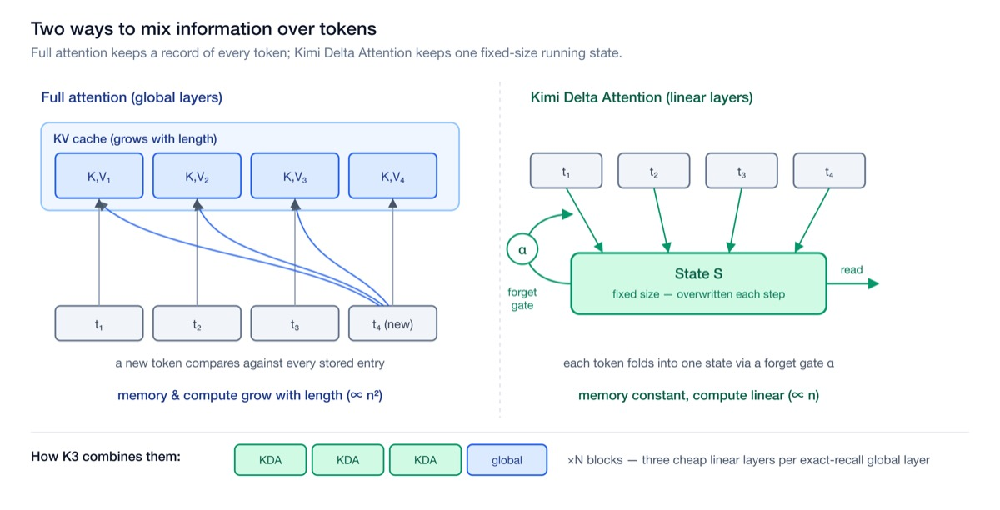</a>
        <h3><a href="https://towardsdatascience.com/how-a-frontier-model-gets-built-read-from-the-kimi-k3-report/" target="_blank" rel="noopener">How a Frontier Model Gets Built, Read from the Kimi K3 Report</a></h3>
        
Moonshot's Kimi K3 is a 2.8-trillion-parameter open-weight model that ranks near the top of third-party leaderboards — yet the report shows most of the work isn't the architecture.

      </li>
      <li class="card">
        <a class="card-img" href="https://medium.com/towards-artificial-intelligence/tokenops-ai-token-spend-is-infrastructure-not-impact-8fefadd99574" target="_blank" rel="noopener" aria-hidden="true" tabindex="-1">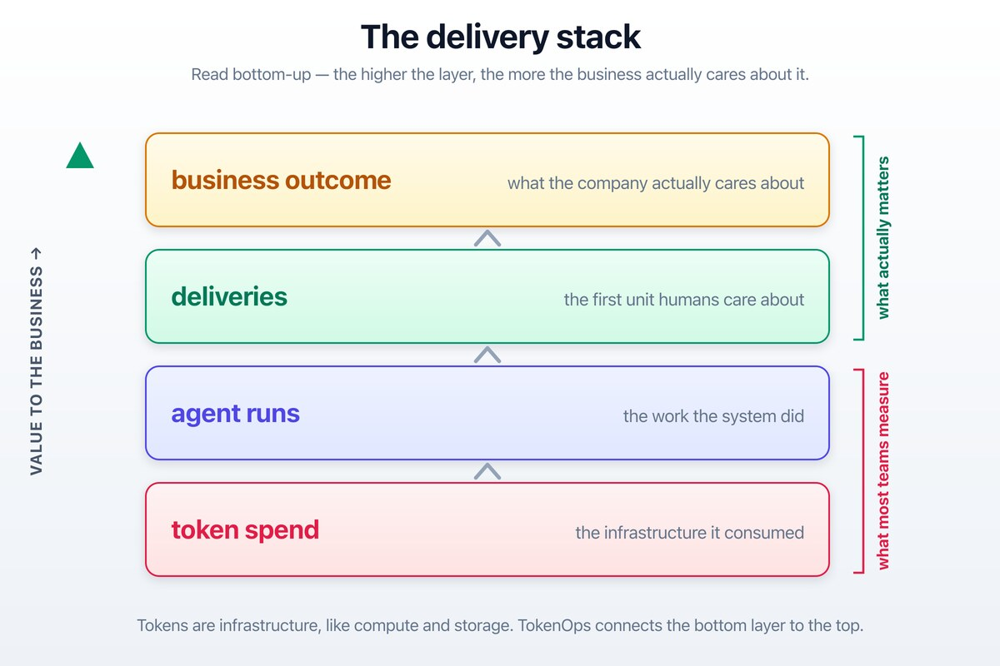</a>
        <h3><a href="https://medium.com/towards-artificial-intelligence/tokenops-ai-token-spend-is-infrastructure-not-impact-8fefadd99574" target="_blank" rel="noopener">Measuring Agentic AI Spend Against Delivery</a></h3>
        
Attributing AI spend to the work it supported, the way FinOps attributed cloud spend to business value.

      </li>
      <li class="card">
        <a class="card-img" href="https://medium.com/data-science-collective/effective-claude-code-workflows-in-2026-what-changed-and-what-works-now-c93ebc6f8f50" target="_blank" rel="noopener" aria-hidden="true" tabindex="-1">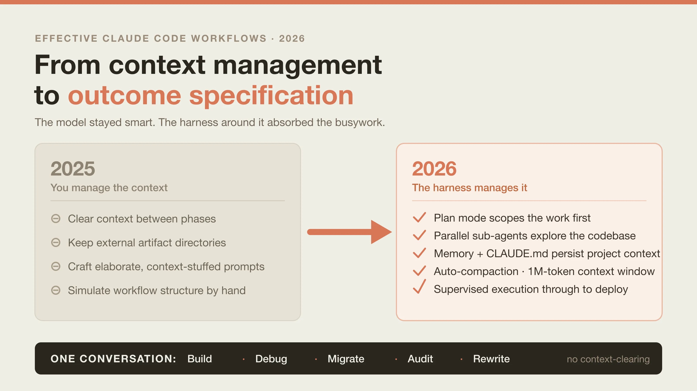</a>
        <h3><a href="https://medium.com/data-science-collective/effective-claude-code-workflows-in-2026-what-changed-and-what-works-now-c93ebc6f8f50" target="_blank" rel="noopener">Effective Claude Code Workflows in 2026: What Changed and What Works Now</a></h3>
        
How to get the most out of Claude Code today, why the harness around the model matters more than the model alone, and what to drop from the 2025 playbook.

      </li>
      <li class="card">
        <a class="card-img" href="https://medium.com/@sean.j.moran/ai-agents-need-more-than-job-orchestration-43e493bb4749" target="_blank" rel="noopener" aria-hidden="true" tabindex="-1">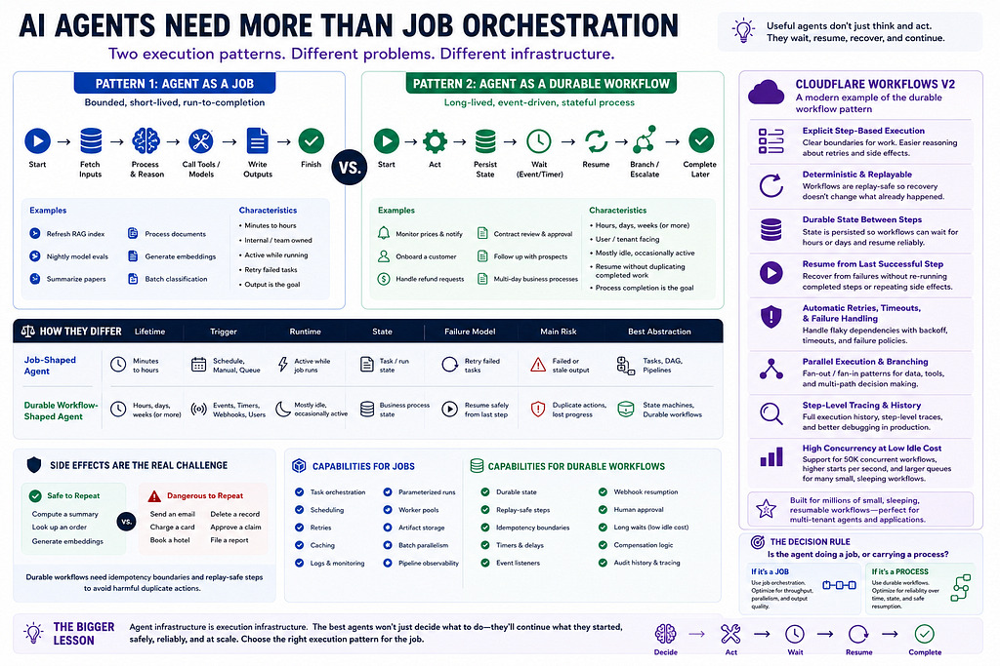</a>
        <h3><a href="https://medium.com/@sean.j.moran/ai-agents-need-more-than-job-orchestration-43e493bb4749" target="_blank" rel="noopener">AI Agents Need More Than Job Orchestration</a></h3>
        
Not all agents are jobs with a clear endpoint.

      </li>
      <li class="card">
        <a class="card-img" href="https://medium.com/@sean.j.moran/llm-agents-are-still-in-the-age-of-phone-whistling-4fc2b4758477" target="_blank" rel="noopener" aria-hidden="true" tabindex="-1">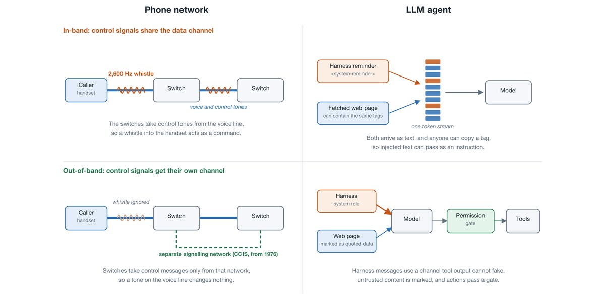</a>
        <h3><a href="https://medium.com/@sean.j.moran/llm-agents-are-still-in-the-age-of-phone-whistling-4fc2b4758477" target="_blank" rel="noopener">Prompt Injection Is an In-Band Signalling Problem</a></h3>
        
A false alarm in Claude Code, a 1960s phone whistle, and why the agent harness, not the model, has to keep instructions apart from untrusted content.

      </li>
      <li class="card">
        <a class="card-img" href="https://medium.com/@sean.j.moran/before-chatgpt-the-2017-openai-emails-are-a-time-capsule-from-the-pre-transformer-agi-race-8f3a5d2a597c" target="_blank" rel="noopener" aria-hidden="true" tabindex="-1">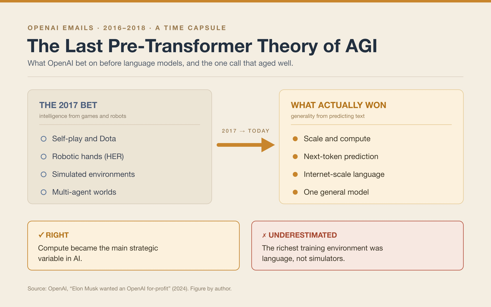</a>
        <h3><a href="https://medium.com/@sean.j.moran/before-chatgpt-the-2017-openai-emails-are-a-time-capsule-from-the-pre-transformer-agi-race-8f3a5d2a597c" target="_blank" rel="noopener">Before ChatGPT: The 2017 OpenAI Emails Are a Time Capsule from the Pre-Transformer AGI Race</a></h3>
        
The released OpenAI emails, read as a record of how AGI strategy looked in the year before the transformer architecture reshaped the field.

      </li>
    </ul>
    
<a href="/writing/">All writing</a>

  </section>

  <section class="content-section" aria-labelledby="built">
    <h2 id="built">Things I’ve built</h2>
    <ul class="card-grid" data-show="3">
      <li class="card">
        <a class="card-img" href="https://sjmoran.github.io/bitbudget/" target="_blank" rel="noopener" aria-hidden="true" tabindex="-1">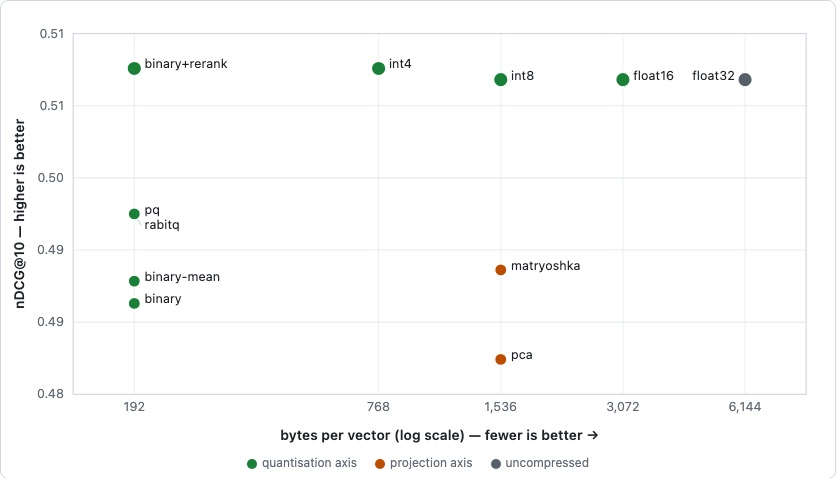</a>
        <h3><a href="https://sjmoran.github.io/bitbudget/" target="_blank" rel="noopener">BitBudget</a></h3>
        
An open benchmark of retrieval quality per byte. One-bit codes with re-ranking match full precision at 32× compression. <a href="https://github.com/sjmoran/bitbudget" target="_blank" rel="noopener">Code</a>.

      </li>
      <li class="card">
        <a class="card-img" href="https://huggingface.co/spaces/sjmoran/the-corpus-is-the-model" target="_blank" rel="noopener" aria-hidden="true" tabindex="-1">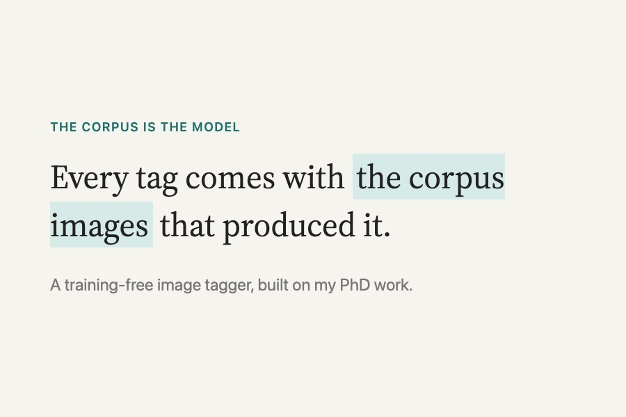</a>
        <h3><a href="https://huggingface.co/spaces/sjmoran/the-corpus-is-the-model" target="_blank" rel="noopener">The Corpus is the Model</a></h3>
        
A training-free image tagger whose every prediction traces back to examples in the corpus. Runs in the browser; give it a few seconds to wake up.

      </li>
      <li class="card">
        <a class="card-img" href="https://github.com/sjmoran/claude-academic-prose" target="_blank" rel="noopener" aria-hidden="true" tabindex="-1">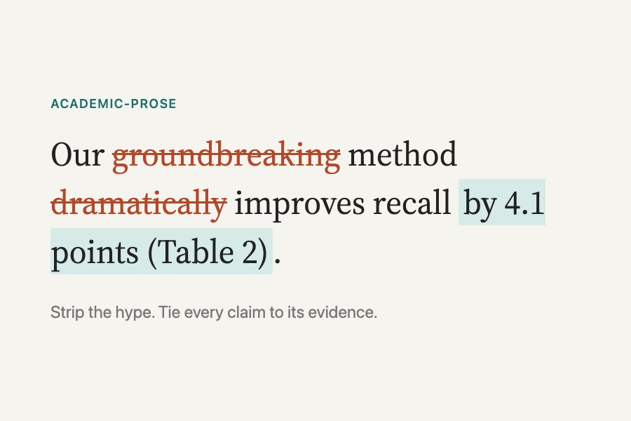</a>
        <h3><a href="https://github.com/sjmoran/claude-academic-prose" target="_blank" rel="noopener">claude-academic-prose</a></h3>
        
A Claude Code skill that strips hype from scientific writing and ties each claim to its evidence.

      </li>
      <li class="card">
        <a class="card-img" href="https://github.com/sjmoran/deep_local_parametric_filters" target="_blank" rel="noopener" aria-hidden="true" tabindex="-1">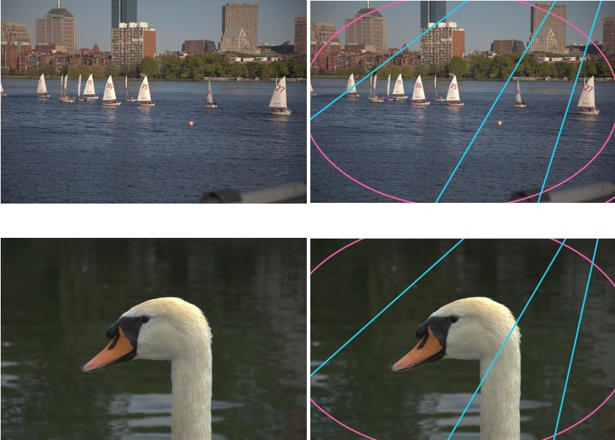</a>
        <h3><a href="https://github.com/sjmoran/deep_local_parametric_filters" target="_blank" rel="noopener">DeepLPF</a></h3>
        
Image enhancement with learned graduated, elliptical and polynomial filters, so you can see what the network chose to do. CVPR 2020.

      </li>
      <li class="card">
        <a class="card-img" href="https://github.com/jpmorganchase/codequest" target="_blank" rel="noopener" aria-hidden="true" tabindex="-1">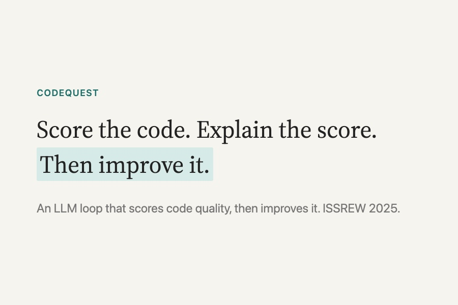</a>
        <h3><a href="https://github.com/jpmorganchase/codequest" target="_blank" rel="noopener">CodeQUEST</a></h3>
        
An LLM loop that evaluates code quality and then improves the code. ISSREW 2025.

      </li>
      <li class="card">
        <a class="card-img" href="https://huggingface.co/datasets/sjmoran/arxiv-tagged-papers" target="_blank" rel="noopener" aria-hidden="true" tabindex="-1">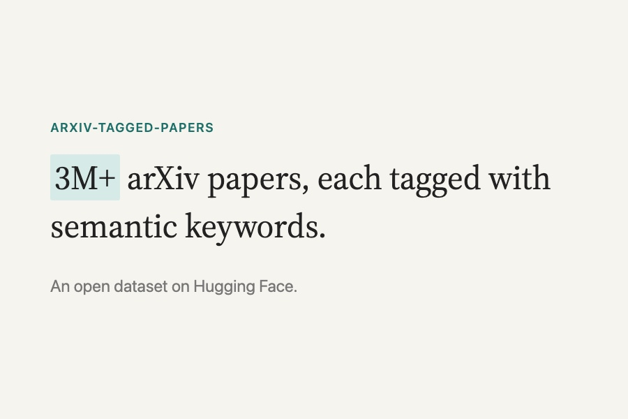</a>
        <h3><a href="https://huggingface.co/datasets/sjmoran/arxiv-tagged-papers" target="_blank" rel="noopener">arxiv-tagged-papers</a></h3>
        
Semantic keyword tags for 3M+ arXiv papers, as an open dataset.

      </li>
    </ul>
    
<a href="/talks/">More code, datasets and talks</a>

  </section>

  <section class="content-section" aria-labelledby="worked">
    <h2 id="worked">Where I’ve worked</h2>
    <ol class="timeline">
      <li>2025–now
<strong>Vergence AI</strong>, the Palantir–TWG Global joint venture. Head of AI (UK). My team builds AI systems with clients and ships them to production.
</li>
      <li>2020–2025
<strong>J.P. Morgan.</strong> Co-founded the CTO Applied Research group, then founded a production-AI team that grew to 45+ people.
</li>
      <li>2018–2020
<strong>Huawei</strong>, London research lab. Image-enhancement models for phones, including <a href="https://arxiv.org/abs/2003.13985" target="_blank" rel="noopener">DeepLPF</a> (CVPR 2020).
</li>
      <li>2016–2018
<strong>Synpromics.</strong> First ML hire at a gene-therapy startup, later acquired by AskBio.
</li>
      <li>2010–2016
<strong>University of Edinburgh.</strong> Research contracts and a PhD in AI with Victor Lavrenko, on learning to hash for large-scale retrieval.
</li>
      <li>2005–2008
<strong>Deutsche Bank.</strong> Software engineer in Commodities Technology, building power-scheduling and gas-trading systems.
</li>
    </ol>
    
<a href="/research/">Research</a> (40+ papers, 20+ US patents) · <a href="{{ site.cv_pdf }}">Full CV</a> · <a href="{{ site.linkedin_url }}" target="_blank" rel="noopener">LinkedIn</a>

  </section>

</article>

